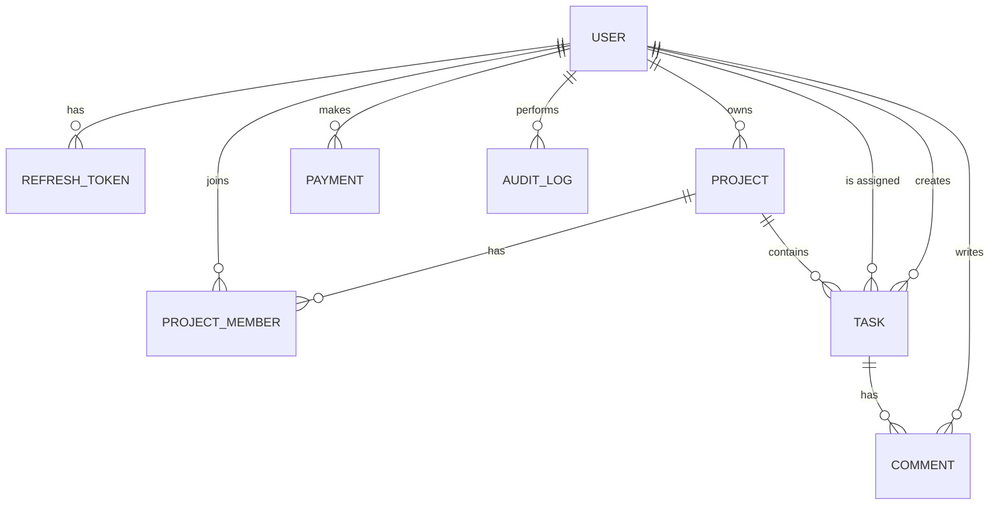

# TaskNest — Project Requirements

**B7A6 · Assignment 8 · Project Management SaaS · Backend only (REST API)**
Version 1 · 2026-11-20 · Built from the four assignment docs in this folder: `README.md`, `project_requirements.md`, `idea-hub.md` (idea #8) and `timeline-breakdown.md`.

> **Goal:** a small but complete backend that meets every mandatory rule of the assignment and is easy to explain in a 5–10 minute video.

---

## 1. Summary

| Item | Decision |
| --- | --- |
| Name | **TaskNest**: project and task management for small teams |
| Why this project | Student ID ends in **8** → Project Management SaaS |
| Type | REST API only, no frontend. Demo with Postman. |
| Roles | **ADMIN**, **MANAGER**, **MEMBER** |
| Stack | Node.js · TypeScript · Express 5 · PostgreSQL + Prisma · Zod · JWT · Google OAuth · SSLCommerz · Upstash Redis · Vitest · Biome · Postman · Vercel |
| Payment | SSLCommerz sandbox: a manager pays **500 BDT** for the **PRO plan (30 days)** |
| Size | 8 tables · 38 endpoints (minimum 20) · about 27 commits (minimum 20) |
| Code folder | `B7A6/tasknest-backend/` (its own git repo; a copy of this file goes into its `docs/`) |
| API base | `/api/v1` |

**Problem.** Small teams (software teams, agencies, student groups) track work in chat groups and spreadsheets. Nobody knows who owns a task, what is late, or what is waiting for review, and there is no record of who changed what.

**Solution.** Every manager gets a private workspace. The manager creates projects, adds team members, creates tasks and assigns them. Members move their tasks through a fixed workflow (TODO → IN_PROGRESS → IN_REVIEW → DONE) and the manager approves the work. Comments and an audit log keep the history. The FREE plan has limits; the manager upgrades to PRO with a real SSLCommerz payment.

**What "small" means.** One workspace level (the manager's account). No organizations, teams, sprints, subtasks, labels or file uploads (§17). Every mandatory rule is still covered (§15).

### How this file follows the assignment docs

| The docs ask for | Section |
| --- | --- |
| Problem, users and roles (idea hub 1–3) | §1, §2 |
| Main workflows (idea hub 4) | §3 |
| Business rules (idea hub 6) | §4 |
| Entities, relationships, ERD (idea hub 5, Day 1) | §5 |
| 20+ APIs, admin operations, analytics (idea hub 10–11) | §6 |
| Versioning, response format, pagination, filtering, search, validation | §7 |
| Authentication, 3 roles, security (README #5, project rules) | §2, §8 |
| Transactions and caching (idea hub 8–9) | §9 |
| Edge cases (idea hub 12) | §10 |
| Tech stack, structure, database | §11 |
| Demo admin account (README #6) | §12 |
| Testing and API docs (README #1, Day 4) | §13 |
| 5-day plan, daily commits and deploys | §14 |
| The 10 mandatory items | §15 |
| Video and submission | §16 |

---

## 2. Roles and permissions

| Role | Who | Can | Cannot |
| --- | --- | --- | --- |
| **ADMIN** | Platform staff. Created by the seed script only. | Manage users (change role, block/unblock), see platform stats, audit logs and all payments. | Register through the API; read or change project/task content (tenant privacy). |
| **MANAGER** | Team lead who owns a workspace. | Create/edit/archive/delete own projects, add/remove members, create/edit/assign/delete tasks, approve or send back work, comment, pay for PRO. | Use admin APIs; see another manager's projects. |
| **MEMBER** | Team member. | See projects they were added to, work on tasks assigned to them, comment. | Create projects or tasks, assign tasks, pay, use admin APIs. |

- At signup the user picks `MANAGER` or `MEMBER` (default `MEMBER`). `ADMIN` is never accepted.
- The role is read from the database on every request, so a role change or a block works at once.
- Wrong role → **403 Forbidden**. A project or task outside your workspace → **404 Not Found** (the API does not reveal that it exists).

### Permission matrix

| Action | ADMIN | MANAGER | MEMBER |
| --- | :-: | :-: | :-: |
| Register | – | ✓ | ✓ |
| Login (password or Google), refresh, logout | ✓ | ✓ | ✓ |
| View and edit own profile | ✓ | ✓ | ✓ |
| Create / edit / archive / delete project | – | own | – |
| List and view projects | – | own | joined |
| Add or remove members | – | own projects | – |
| List members | – | own projects | joined projects |
| Create / edit / delete / assign task | – | own projects | – |
| Change task status | – | own projects (all moves) | own tasks (TODO ↔ IN_PROGRESS → IN_REVIEW) |
| Comment on tasks | – | own projects | joined projects |
| Start payment (upgrade to PRO) | – | ✓ | – |
| View payments | all | own | – |
| Admin APIs (users, roles, status, stats, audit logs) | ✓ | – | – |

---

## 3. Main workflows

### 3.1 Team work

```text
MANAGER                                   MEMBER
  │ 1. create project
  │ 2. add member by email  ───────────►  sees the project
  │ 3. create task + assign ───────────►  task is in TODO
  │                                       4. TODO → IN_PROGRESS → IN_REVIEW
  │ 5. review the task:
  │      approve   → DONE
  │      send back → IN_PROGRESS ──────►  works on it again
  │
  └── both sides comment; every change is written to the audit log
```

### 3.2 Task status workflow (state machine)

| From | To | Who can do it | Note |
| --- | --- | --- | --- |
| TODO | IN_PROGRESS | assignee, project owner | task must have an assignee |
| IN_PROGRESS | TODO | assignee, project owner | stop work |
| IN_PROGRESS | IN_REVIEW | assignee, project owner | submit for review |
| IN_REVIEW | IN_PROGRESS | project owner | send back for changes |
| IN_REVIEW | DONE | project owner | approve; sets `completedAt` |
| DONE | IN_PROGRESS | project owner | reopen; clears `completedAt` |

Any other move → **409 Conflict** (for example "Cannot move task from DONE to TODO").

### 3.3 Upgrade to PRO (payment)

```text
1. Manager hits a FREE limit         → 402 "Plan limit reached. Upgrade to PRO."
2. POST /payments/initiate           → TaskNest saves a PENDING payment and asks SSLCommerz for a session
                                     ← { paymentId, tranId, amount, paymentUrl }
3. Manager opens paymentUrl in a browser and pays with an SSLCommerz sandbox card
4. SSLCommerz → POST /payments/success (browser redirect) and POST /payments/ipn (server to server)
5. TaskNest → SSLCommerz validation API with val_id: status VALID? same tran_id? same amount? BDT?
6. One DB transaction: payment PAID + manager plan PRO (+30 days) + audit log
7. GET /payments/:id → status PAID, and the blocked action now works
   (the fail / cancel callbacks mark the payment FAILED / CANCELLED, never PAID)
```

---

## 4. Business rules

**Accounts**

- **BR-1** Email is unique (saved in lowercase). Password: 8–64 characters with at least one letter and one number, hashed with bcrypt.
- **BR-2** The signup role is `MANAGER` or `MEMBER` only (default `MEMBER`).
- **BR-3** Google login: Google must report the email as verified. If the email already has an account, the Google ID is linked to it. If not, a new account is created (role from `?role=`, default `MEMBER`, no password).
- **BR-4** A `BLOCKED` user cannot log in, refresh tokens, or use an old access token (403).
- **BR-5** The access token lives 15 minutes. The refresh token lives 7 days, is stored only as a SHA-256 hash and is replaced on every refresh (rotation). A used or revoked refresh token → 401. Logout revokes all of the user's refresh tokens.

**Projects and members**

- **BR-6** Only a MANAGER can create a project and becomes its owner. A manager works only inside their own projects; a member works only inside projects they were added to.
- **BR-7** Project status is `ACTIVE` or `ARCHIVED`. An archived project is read-only (no task, member, comment or status changes) and does not count toward the plan limit. Making it `ACTIVE` again checks the limit.
- **BR-8** Plan limits. Over the limit → **402 Payment Required** with "Upgrade to PRO".

  | Plan | Price | Active projects | Members per project |
  |---|---|---|---|
  | FREE | 0 | 2 | 3 |
  | PRO | 500 BDT for 30 days | no limit | no limit |

- **BR-9** Members are added by email. The user must exist, be `ACTIVE` and have role `MEMBER`. Adding the same person twice → 409.
- **BR-10** When a member is removed, their unfinished tasks in that project become unassigned and go back to `TODO` (same transaction). `DONE` tasks keep the assignee as history. Adding the person again restores the membership.
- **BR-11** Deleting a project is a soft delete (`deletedAt`). Its tasks are soft-deleted in the same transaction.

**Tasks**

- **BR-12** Only the project owner creates, edits, assigns and deletes (soft delete) tasks.
- **BR-13** The assignee must be an active member of the project. A `DONE` task cannot be reassigned. A task can be unassigned only while it is `TODO`.
- **BR-14** A task needs an assignee before it can leave `TODO`.
- **BR-15** Status changes follow §3.2 only.
- **BR-16** A due date cannot be in the past when it is set. A task is **overdue** when `dueDate < now` and its status is not `DONE`.
- **BR-17** The owner and the project's members can comment (1–2000 characters).

**Plans and payments**

- **BR-18** Only a MANAGER can pay. The amount comes from the server (PRO = 500.00 BDT), never from the request body.
- **BR-19** A payment becomes `PAID` only after the server checks `val_id` with the SSLCommerz validation API (status `VALID` or `VALIDATED`, same `tran_id`, same amount, currency BDT). The fail and cancel callbacks can never set `PAID`.
- **BR-20** Payment handling is idempotent: the success callback plus the IPN (or a replayed callback) activate the plan only once.
- **BR-21** PRO adds 30 days: from now if the manager is on FREE or expired, from the current end date if PRO is still active.
- **BR-22** When PRO ends, FREE limits apply to new actions. Existing data is kept.

**Admin and audit**

- **BR-23** The admin can change roles only between `MANAGER` and `MEMBER`. A manager who still owns active projects cannot become a member, and a member who is still in projects cannot become a manager (409).
- **BR-24** The admin can block and unblock users, but not themselves or another admin (409). Blocking revokes the user's refresh tokens.
- **BR-25** These actions write an audit log row in the same transaction as the change: role or status change, project create/update/delete, member add/remove, task create/update/assign/status change/delete, payment paid/failed/cancelled.

---

## 5. Data model

PostgreSQL (Prisma Postgres) through Prisma ORM. All tables live in their own Postgres schema, **`tasknest`** (see §11.3).



| Table | Main fields | Constraints and indexes |
| --- | --- | --- |
| `users` | id (uuid), name, email, passwordHash?, googleId?, avatarUrl?, role (ADMIN/MANAGER/MEMBER), status (ACTIVE/BLOCKED), plan (FREE/PRO), planExpiresAt?, createdAt, updatedAt | unique email, unique googleId; index role, status |
| `refresh_tokens` | id, userId, tokenHash, expiresAt, revokedAt?, createdAt | unique tokenHash; index userId; FK → users |
| `projects` | id, ownerId, name, description?, status (ACTIVE/ARCHIVED), dueDate?, deletedAt?, createdAt, updatedAt | index (ownerId, deletedAt), status; FK → users |
| `project_members` | id, projectId, userId, removedAt?, createdAt | unique (projectId, userId); index userId; FKs |
| `tasks` | id, projectId, title, description?, status (TODO/IN_PROGRESS/IN_REVIEW/DONE), priority (LOW/MEDIUM/HIGH/URGENT), assigneeId?, createdById, dueDate?, completedAt?, deletedAt?, createdAt, updatedAt | index (projectId, status), (assigneeId, status), dueDate; FKs |
| `comments` | id, taskId, authorId, body, createdAt, updatedAt | index (taskId, createdAt); FKs |
| `payments` | id, userId, plan, amount Decimal(10,2), currency, tranId, status (PENDING/PAID/FAILED/CANCELLED), valId?, bankTranId?, cardType?, gatewayData (JSON)?, paidAt?, createdAt, updatedAt | unique tranId; index (userId, createdAt), status; FK → users |
| `audit_logs` | id, actorId?, action, entityType (USER/PROJECT/TASK/PAYMENT), entityId, metadata (JSON)?, createdAt | index createdAt, actorId, (entityType, entityId); FK → users |

- Enums are real Postgres enums. Foreign keys use `Restrict` because nothing is hard-deleted (refresh tokens are the only `Cascade`).
- Soft delete: `projects.deletedAt`, `tasks.deletedAt`, `project_members.removedAt`. Every query filters them out.
- Money is `Decimal(10,2)` and is returned as a string (`"500.00"`).
- Audit actions: `USER_ROLE_CHANGED`, `USER_STATUS_CHANGED`, `PROJECT_CREATED`, `PROJECT_UPDATED`, `PROJECT_DELETED`, `MEMBER_ADDED`, `MEMBER_REMOVED`, `TASK_CREATED`, `TASK_UPDATED`, `TASK_ASSIGNED`, `TASK_STATUS_CHANGED`, `TASK_DELETED`, `PAYMENT_PAID`, `PAYMENT_FAILED`, `PAYMENT_CANCELLED`.

---

## 6. API endpoints (38)

Base URL `/api/v1`. 🔓 = public. Every other endpoint needs `Authorization: Bearer <accessToken>`.

### 6.1 Auth (6)

| # | Method and path | Access | What it does |
| --- | --- | --- | --- |
| 1 | `POST /auth/register` | 🔓 | Create account (`name`, `email`, `password`, `role?`) → user + tokens |
| 2 | `POST /auth/login` | 🔓 | Email + password → user + tokens |
| 3 | `POST /auth/refresh-token` | 🔓 | `refreshToken` → new token pair (the old one is revoked) |
| 4 | `POST /auth/logout` | any role | Revoke all of the user's refresh tokens |
| 5 | `GET /auth/google` | 🔓 | Redirect to Google (`?role=MANAGER` or `MEMBER` for new accounts) |
| 6 | `GET /auth/google/callback` | 🔓 | Google returns here → user + tokens as JSON |

### 6.2 Profile (2)

| # | Method and path | Access | What it does |
| --- | --- | --- | --- |
| 7 | `GET /users/me` | any role | Profile, plan, plan end date, limits and usage |
| 8 | `PATCH /users/me` | any role | Update `name`, `avatarUrl` |

### 6.3 Projects and members (8)

| # | Method and path | Access | What it does |
| --- | --- | --- | --- |
| 9 | `POST /projects` | MANAGER | Create project (plan limit, transaction) |
| 10 | `GET /projects` | MANAGER, MEMBER | Own or joined projects · pagination, search, filter, sort |
| 11 | `GET /projects/:id` | MANAGER, MEMBER | Details + stats: tasks by status, overdue count, progress %, member count |
| 12 | `PATCH /projects/:id` | MANAGER (owner) | Update name, description, dueDate, status (archive or activate) |
| 13 | `DELETE /projects/:id` | MANAGER (owner) | Soft delete the project and its tasks |
| 14 | `POST /projects/:id/members` | MANAGER (owner) | Add a member by `email` (member limit) |
| 15 | `GET /projects/:id/members` | MANAGER, MEMBER | List members |
| 16 | `DELETE /projects/:id/members/:userId` | MANAGER (owner) | Remove a member and unassign their open tasks |

### 6.4 Tasks and comments (10)

| # | Method and path | Access | What it does |
| --- | --- | --- | --- |
| 17 | `POST /projects/:id/tasks` | MANAGER (owner) | Create a task (optional `assigneeId`) |
| 18 | `GET /tasks` | MANAGER, MEMBER | Tasks in my projects · pagination, search, filters, sort |
| 19 | `GET /tasks/my-assigned` | MEMBER | Tasks assigned to me |
| 20 | `GET /tasks/:id` | MANAGER, MEMBER | Task details |
| 21 | `PATCH /tasks/:id` | MANAGER (owner) | Edit title, description, priority, dueDate |
| 22 | `DELETE /tasks/:id` | MANAGER (owner) | Soft delete |
| 23 | `PATCH /tasks/:id/status` | MANAGER (owner), MEMBER (assignee) | Move the status (§3.2) |
| 24 | `PATCH /tasks/:id/assign` | MANAGER (owner) | Assign, reassign or unassign (`assigneeId` or `null`) |
| 25 | `POST /tasks/:id/comments` | MANAGER, MEMBER | Add a comment |
| 26 | `GET /tasks/:id/comments` | MANAGER, MEMBER | List comments (paginated, oldest first) |

### 6.5 Payments (7)

| # | Method and path | Access | What it does |
| --- | --- | --- | --- |
| 27 | `POST /payments/initiate` | MANAGER | Start a PRO payment → `paymentUrl` |
| 28 | `POST /payments/success` | 🔓 SSLCommerz | Validate with SSLCommerz → PAID + PRO |
| 29 | `POST /payments/fail` | 🔓 SSLCommerz | Mark FAILED |
| 30 | `POST /payments/cancel` | 🔓 SSLCommerz | Mark CANCELLED |
| 31 | `POST /payments/ipn` | 🔓 SSLCommerz | Server-to-server confirmation (same check as success) |
| 32 | `GET /payments` | MANAGER (own), ADMIN (all) | Payment history · pagination, status filter |
| 33 | `GET /payments/:id` | MANAGER (own), ADMIN | One payment and its status |

### 6.6 Admin (5)

| # | Method and path | Access | What it does |
| --- | --- | --- | --- |
| 34 | `GET /admin/users` | ADMIN | Users · search (name, email), filter role/status, pagination |
| 35 | `PATCH /admin/users/:id/role` | ADMIN | Change role (BR-23) |
| 36 | `PATCH /admin/users/:id/status` | ADMIN | Block or unblock (BR-24) |
| 37 | `GET /admin/stats` | ADMIN | Users by role, blocked users, projects, tasks by status, overdue tasks, revenue, active PRO managers (cached) |
| 38 | `GET /admin/audit-logs` | ADMIN | Audit logs · filter by action, actor, entity, date range · pagination |

Also `GET /health` (not counted) for deployment checks.

---

## 7. API rules

### 7.1 Response format (every endpoint, including errors)

Success:

```json
{ "success": true, "message": "Project created", "data": { } }
```

List (pagination in `meta`):

```json
{ "success": true, "message": "Projects retrieved", "data": [ ], "meta": { "page": 1, "limit": 10, "total": 23, "totalPages": 3 } }
```

Error:

```json
{ "success": false, "message": "Validation failed", "errors": [ { "field": "email", "message": "Invalid email address" } ] }
```

The same error shape is used for unknown routes (404), rate limits (429), malformed JSON (400) and server errors (500).

### 7.2 Status codes

| Code | When |
| --- | --- |
| 200 / 201 | OK / created |
| 302 | Redirect to Google |
| 400 | Validation failed, malformed JSON, bad ID |
| 401 | Missing, invalid or expired token; wrong email or password |
| 402 | Plan limit reached; upgrade to PRO |
| 403 | Role not allowed, account blocked, not your task |
| 404 | Not found, deleted, outside your workspace, unknown route |
| 409 | Duplicate (email, member), invalid status move, business-rule conflict |
| 429 | Too many requests |
| 502 | The payment gateway did not answer correctly |
| 500 | Unexpected error (generic message, no stack trace in production) |

### 7.3 Lists: pagination, search, filter, sort

- Every list takes `page` (default 1) and `limit` (default 10, max 100).
- Sorting uses `sortBy` plus `sortOrder` (`asc` or `desc`). Only the fields below are allowed.

| Endpoint | `search` looks in | Filters | `sortBy` |
| --- | --- | --- | --- |
| `GET /projects` | name, description | status | createdAt, name, dueDate |
| `GET /tasks` | title, description | projectId, status, priority, assigneeId, overdue=true | createdAt, dueDate, priority, title |
| `GET /tasks/my-assigned` | – | status, priority, overdue=true | createdAt, dueDate, priority |
| `GET /payments` | – | status | createdAt |
| `GET /admin/users` | name, email | role, status | createdAt, name |
| `GET /admin/audit-logs` | – | action, actorId, entityType, entityId, from, to | createdAt |

### 7.4 Validation

- Zod schemas check `body`, `params` and `query` on every route that takes input. Unknown fields are rejected (for example `role` in `PATCH /users/me` → 400).
- IDs are UUIDs; a bad ID → 400 (never a raw database error).
- Dates are ISO 8601 and stored in UTC.

---

## 8. Authentication and security

- **Email and password:** bcrypt hash (10 rounds). Login errors stay generic ("Invalid email or password").
- **Google (GCP OAuth 2.0):** server-side code flow with `google-auth-library`. A random `state` value is kept in a short-lived httpOnly cookie and checked on the callback (CSRF protection). Start it in a browser; the callback returns the tokens as JSON to paste into Postman.
- **JWT:** access token (15 min) in `Authorization: Bearer`; refresh token (7 days) in the request body. The payload holds only `userId` and `role`. Secrets come from env (at least 32 characters).
- **Middleware chain:** `auth` (checks the token, loads the user, rejects blocked users) → `authorize(...roles)` (403) → `validate(schema)` (400).
- **Workspace isolation:** every project and task query includes the owner or membership condition.
- **Protection:** `helmet`, CORS allowlist from env, `express-rate-limit` (300 requests / 15 min per IP overall; 20 / 15 min for login, register and refresh), JSON body limit 100 kb, `trust proxy` on Vercel.
- **No leaks:** Prisma `select` never returns `passwordHash` or token hashes; logs never contain passwords or tokens; `.env` is git-ignored.
- **Payments:** the callback routes are public but trusted only after the server-to-server validation call (BR-19).

---

## 9. Transactions, caching, performance

### 9.1 Transactions (Prisma interactive transactions)

| Operation | Inside one transaction | Race protection |
| --- | --- | --- |
| Create project / make a project active again | lock the owner row → count active projects → insert or update → audit log | `SELECT … FOR UPDATE` on the owner stops two parallel requests from both passing the limit |
| Add member | lock the project row → count members → insert or restore → audit log | row lock on the project |
| Remove member | soft-remove the membership → unassign open tasks and set them to TODO → audit log | – |
| Delete project | soft delete the project and its tasks → audit log | – |
| Change task status | update only `WHERE status = <old status>` → audit log | 0 rows updated → 409 "Task was changed by someone else" |
| Payment success / IPN | update only `WHERE status = PENDING` → extend the plan → audit log | runs once even if success and IPN arrive together |
| Refresh token | revoke the old token and create the new one | – |

### 9.2 Caching (Upstash Redis, optional)

| Data | Key | TTL | Cleared when |
| --- | --- | --- | --- |
| Admin stats | `admin:stats` | 60 s | TTL only (60 seconds old is fine for stats) |
| Project stats in `GET /projects/:id` | `project:<id>:stats` | 5 min | any task create/update/assign/status/delete in that project, member add/remove, project delete |

If the Redis env vars are missing, or Redis fails, the API works without cache. A cache error never breaks a request.

### 9.3 Performance

- The indexes in §5 match the filters in §7.3.
- `select` only the needed fields; counts use `groupBy` / `_count` instead of loading rows.
- `limit` is capped at 100. One shared Prisma client (safe for serverless).

---

## 10. Edge cases

| Case | Result |
| --- | --- |
| Register with an email that exists | 409 |
| Google login with an email that already has a password account | Google ID linked, login works |
| Password login on a Google-only account | 401 (generic message) |
| Expired access token | 401 "Token expired" |
| Used, revoked or expired refresh token | 401 |
| Blocked user with an old access token | 403 |
| `role` or other unknown field in `PATCH /users/me` | 400 |
| Member calls `POST /projects`, manager calls `/admin/*`, admin calls `/projects` | 403 |
| Manager or member opens a project outside their workspace | 404 |
| Add a manager, admin, blocked or unknown user as member | 400 |
| Add the same member twice | 409 |
| Assign a task to someone who is not a member | 400 |
| Unassign a task that is IN_PROGRESS, or reassign a DONE task | 409 |
| Move a task out of TODO with no assignee | 409 |
| Invalid move, for example DONE → TODO | 409 |
| Member changes a task that is not assigned to them | 403 |
| Two people change the same task at the same time | second one gets 409 |
| Due date in the past | 400 |
| Any change inside an archived project | 409 "Project is archived" |
| FREE manager creates a 3rd active project or adds a 4th member | 402 |
| Two "create project" requests at the limit at the same moment | only one succeeds |
| Task of a deleted project | 404 |
| Callback amount, currency or tran_id does not match the validation result | payment FAILED, plan unchanged |
| Success callback replayed, or IPN after success | no second upgrade (same response) |
| Callback with an unknown tran_id | 404 |
| SSLCommerz down during initiate | payment FAILED, 502 |
| Paying while PRO is still active | +30 days from the current end date |
| Admin blocks themselves or another admin; demotes a manager who owns projects | 409 |
| Invalid UUID / unknown route / malformed JSON / too many requests | 400 / 404 / 400 / 429 |

---

## 11. Tech stack, structure, database, environment

### 11.1 Tech stack

| Need | Choice | Why |
| --- | --- | --- |
| Runtime, framework | Node.js 22+ (LTS), TypeScript (strict), Express 5 | assignment stack; Express 5 catches async errors |
| Database, ORM | PostgreSQL (Prisma Postgres) + Prisma ORM | required; relations, migrations, transactions |
| Validation | Zod | required |
| Auth | own JWT (`jsonwebtoken`), `bcryptjs`, `google-auth-library` | simple and easy to explain |
| Payment | SSLCommerz sandbox over plain HTTPS (`fetch`) | real gateway, BDT |
| Cache | Upstash Redis (`@upstash/redis`) | works on serverless, free tier |
| Security | helmet, cors, express-rate-limit, cookie-parser (OAuth state only) | required |
| Lint and format | Biome | one small tool |
| Tests | Vitest + Supertest | fast, simple |
| API docs | Postman collection + environment | required |
| Deploy | Vercel (serverless function) | required |

### 11.2 Folder structure (Routes → Controllers → Services → Prisma)

```text
tasknest-backend/
├─ prisma/
│  ├─ schema.prisma        8 models in the "tasknest" schema
│  ├─ migrations/
│  └─ seed.ts              demo accounts, project, tasks
├─ src/
│  ├─ app.ts               express app: security → /api/v1 routes → 404 → error handler
│  ├─ server.ts            local server (app.listen)
│  ├─ config/env.ts        Zod-checked environment
│  ├─ lib/                 prisma, cache, jwt, google, sslcommerz
│  ├─ middlewares/         auth, authorize, validate, rateLimit, notFound, errorHandler
│  ├─ utils/               AppError, sendResponse, pagination, audit
│  ├─ modules/
│  │  ├─ auth/  users/  projects/  tasks/  payments/  admin/
│  │  │    each: *.routes.ts → *.controller.ts → *.service.ts (+ *.validation.ts)
│  └─ routes.ts            mounts every module under /api/v1
├─ tests/                  unit + integration
├─ docs/                   REQUIREMENTS.md, Postman collection + environment
└─ .env.example  README.md  PROGRESS.md  biome.json  tsconfig.json  package.json
```

### 11.3 Database connection

- `DATABASE_URL` is the Prisma Postgres URL you gave. It is stored only in `tasknest-backend/.env` (git-ignored) and in the Vercel environment settings. It never goes into code, docs or commits.
- The old `teamflow-backend/.env` points at this same database. TaskNest therefore keeps all its tables in a separate Postgres schema, `tasknest` (the URL gets `&schema=tasknest`), so the TeamFlow tables are never touched. Tests use the schema `tasknest_test`.
- Never run `prisma migrate reset` or `prisma db push --force-reset` on this database.
- If the database user is not allowed to create a schema, create a second database in the Prisma Console and use its URL instead.

### 11.4 Environment variables (`.env.example`)

| Variable | Example | Used for |
| --- | --- | --- |
| `NODE_ENV` | `development` | mode |
| `PORT` | `5000` | local server |
| `APP_URL` | `http://localhost:5000` | Google and SSLCommerz callback URLs |
| `DATABASE_URL` | `postgres://…&schema=tasknest` | database |
| `JWT_ACCESS_SECRET`, `JWT_REFRESH_SECRET` | 32+ random characters each | tokens |
| `JWT_ACCESS_EXPIRES_IN`, `JWT_REFRESH_EXPIRES_IN` | `15m`, `7d` | tokens |
| `CORS_ORIGINS` | `*` | CORS |
| `GOOGLE_CLIENT_ID`, `GOOGLE_CLIENT_SECRET` | from Google Cloud Console | Google login |
| `SSLC_STORE_ID`, `SSLC_STORE_PASSWORD` | from the SSLCommerz sandbox | payment |
| `SSLC_IS_LIVE` | `false` | sandbox or live |
| `UPSTASH_REDIS_REST_URL`, `UPSTASH_REDIS_REST_TOKEN` | optional | cache |
| `ADMIN_EMAIL`, `ADMIN_PASSWORD` | `admin@tasknest.com` | seed |

All values are checked with Zod at startup. The app stops with a clear message if a required one is missing.

---

## 12. Seed data and demo accounts

`npm run db:seed` is safe to run again (it upserts).

| Role | Email | Password (demo only) |
| --- | --- | --- |
| ADMIN | `admin@tasknest.com` | `Admin@12345` (from `ADMIN_PASSWORD`) |
| MANAGER | `manager@tasknest.com` | `Manager@123` |
| MEMBER | `rahim@tasknest.com` | `Member@123` |
| MEMBER | `karim@tasknest.com` | `Member@123` |

Plus one active project, "Website Redesign" (owner: manager, members: Rahim and Karim), with 5 tasks (one in each status, one overdue) and 2 comments. The manager starts on FREE with 1 project, so the video can show: create project 2 ✓ → project 3 → 402 → pay → project 3 ✓.

---

## 13. Testing and documentation

- **Unit tests (Vitest):** status-move rules, plan-limit rules, pagination and sort parsing.
- **Integration tests (Vitest + Supertest, real app, schema `tasknest_test`):** auth flow; 401/403/404/400 cases; project → member → task → status flow; plan limit 402; soft delete; payment callbacks (only in tests the SSLCommerz HTTP calls are mocked).
- **Real payment check:** one full SSLCommerz sandbox payment on localhost and one on the live URL.
- `npm run typecheck`, `npm run lint` and `npm test` must pass before every push.
- **Postman:** one collection with a folder per module; every endpoint has an example body and saved example responses (success and error); an environment with `baseUrl`; the login requests save `accessToken` and `refreshToken` automatically; separate logins for admin, manager and member. Publish it with Postman "Publish docs" to get the link for submission.
- **README:** overview, roles, architecture, ERD, setup, env vars, endpoint list, demo accounts, sandbox payment steps, live links.
- **PROGRESS.md** in the repo: what is done and what is next, updated after each phase.

---

## 14. Build plan (5 days) and commits

Each day ends with tests passing, commits, and a deploy, as `timeline-breakdown.md` asks.

| Day | Work | Done when |
| --- | --- | --- |
| 1. Setup and database | Project setup (TypeScript, Express 5, Biome), env check, Prisma schema (8 tables) in schema `tasknest`, first migration, seed, `/health`, git init, first Vercel deploy | `/health` works live; seed data in the database |
| 2. Auth and profile | Response and error helpers, security middleware, register/login/refresh/logout, `auth` + `authorize`, Google login, `/users/me` | all 3 roles log in; 401 and 403 work |
| 3. Core and business logic | Audit helper, projects + plan limit, members, tasks, status workflow, assignment, comments, list params, Redis cache | §3.1 workflow runs end to end in Postman |
| 4. Payment, admin, tests, docs | SSLCommerz initiate/success/fail/cancel/IPN, payment history, admin APIs, tests, Postman collection | a sandbox payment upgrades a manager; tests pass |
| 5. Deploy and submit | Vercel env vars, production migrate + seed, live checks for every role, README, video, submission | every §15 item ticked |

**Planned commits (27, minimum 20):**

| Day | Commit messages |
| --- | --- |
| 1 | `chore: initialize TypeScript Express project with Biome` · `feat: add Zod-validated environment config` · `feat: add Prisma schema for users, projects, tasks, payments and audit logs` · `feat: add seed script with demo accounts and sample project` · `chore: add health endpoint and Vercel config` |
| 2 | `feat: add response helper and global error handler` · `feat: add helmet, CORS and rate limiting` · `feat: add register and login with JWT` · `feat: add refresh token rotation and logout` · `feat: add auth and role authorization middlewares` · `feat: add Google OAuth login` · `feat: add profile endpoints` |
| 3 | `feat: add audit log helper` · `feat: add project CRUD with search, filters and pagination` · `feat: enforce FREE plan limits with row locking` · `feat: add project member management` · `feat: add task CRUD with filters and sorting` · `feat: add task status workflow and assignment` · `feat: add task comments` · `feat: cache project and admin stats in Redis` |
| 4 | `feat: add SSLCommerz payment initiation` · `feat: validate SSLCommerz callbacks and activate PRO plan` · `feat: add admin users, stats and audit log APIs` · `test: add unit and integration tests` · `docs: add Postman collection and environment` |
| 5 | `docs: write README with setup, API list and demo accounts` · `fix: …` (anything found in live testing) |

Commits use `feat:` / `fix:` / `test:` / `docs:` / `chore:` prefixes.

---

## 15. Mandatory checklist (from README.md)

| # | Mandatory item | How TaskNest meets it |
| --- | --- | --- |
| 1 | API documentation | Published Postman collection (§13) |
| 2 | Consistent responses | One success/error format everywhere (§7.1) |
| 3 | 20+ meaningful commits | 27 planned (§14) |
| 4 | Server-side validation | Zod on body, params and query (§7.4) |
| 5 | Email/password + Google login, 3 roles | §2, §8 |
| 6 | Demo admin credentials | Seeded admin (§12) |
| 7 | Real payment | SSLCommerz with server-side validation (§3.3, BR-18 to BR-22) |
| 8 | PostgreSQL + Prisma: relations, constraints, indexes, transactions | §5, §9 |
| 9 | Live API URL | Vercel (§14, day 5) |
| 10 | 5–10 minute video | §16 |

Also covered from `project_requirements.md`: `/api/v1` versioning, Bearer tokens, role middleware, pagination, filtering, sorting, search, soft delete, audit logs, business logic beyond CRUD, password hashing, rate limiting, helmet, CORS, indexes, `select`, Redis, transactions against race conditions.

---

## 16. Video plan and submission

**Video (5–10 minutes, Postman):**

1. **Overview (1 min):** the problem, the 3 roles, Routes → Controllers → Services → Prisma, the ERD.
2. **3 roles (2 min):** log in as admin, manager and member. Member calls `POST /projects` → 403. Manager calls `GET /admin/users` → 403. No token → 401.
3. **CRUD (2 min):** create a project → add a member → create and assign a task → member moves it to IN_REVIEW → manager approves (DONE) → edit → soft delete → GET returns 404.
4. **Validation and errors (1 min):** register with a bad email → 400 with `errors`; DONE → TODO → 409; unknown route → 404.
5. **Payment (2 min):** project 3 → 402 → `POST /payments/initiate` → pay on the SSLCommerz sandbox page → success callback → `GET /payments/:id` shows PAID → project 3 now works.
6. **One technical challenge (1 min):** the plan limit with a row lock, or the idempotent payment validation.

**Submission format:**

```text
Project Name    : TaskNest – Project Management SaaS
Backend Repo    : https://github.com/<your-username>/tasknest-backend
Live API        : https://<your-project>.vercel.app
API Docs        : https://documenter.getpostman.com/view/<id>
Demo Video      : <Loom or Google Drive link, "Anyone with the link">
Admin Email     : admin@tasknest.com
Admin Password  : <the demo password from §12>
```

---

## 17. Out of scope (keeps the project small)

Organizations and teams, sprints, subtasks, labels, mentions, file attachments (Multer + Cloudinary), email notifications, calendar view, real-time updates, email invitations, password reset by email, any frontend.

If time is left after day 5, the first extra would be task attachments with Multer + Cloudinary.

---

## 18. Credentials and accounts needed

| When | What |
| --- | --- |
| Day 2 | Google OAuth **Client ID + Client Secret** (Google Cloud Console → Credentials → OAuth client ID → Web application). Redirect URIs: `http://localhost:5000/api/v1/auth/google/callback`, and later the Vercel URL + `/api/v1/auth/google/callback`. |
| Day 3 (optional) | Upstash Redis REST URL + token. Without them the API runs without cache. |
| Day 4 | SSLCommerz sandbox **Store ID + Store Password** (free at developer.sslcommerz.com/registration). |
| Day 1 and 5 | An empty GitHub repo `tasknest-backend` (or permission to create it) and a Vercel login for deploys. |
| Day 5 | Publish the Postman docs from the Postman account; record the video. |
